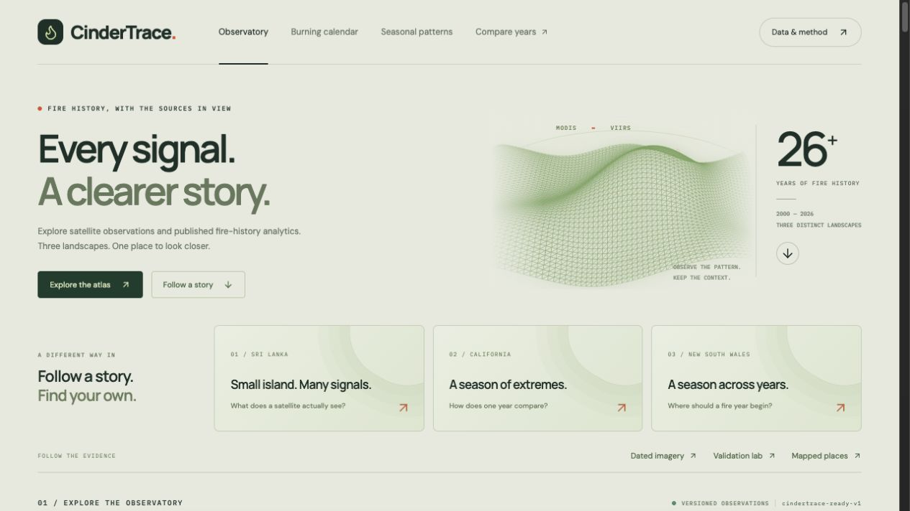
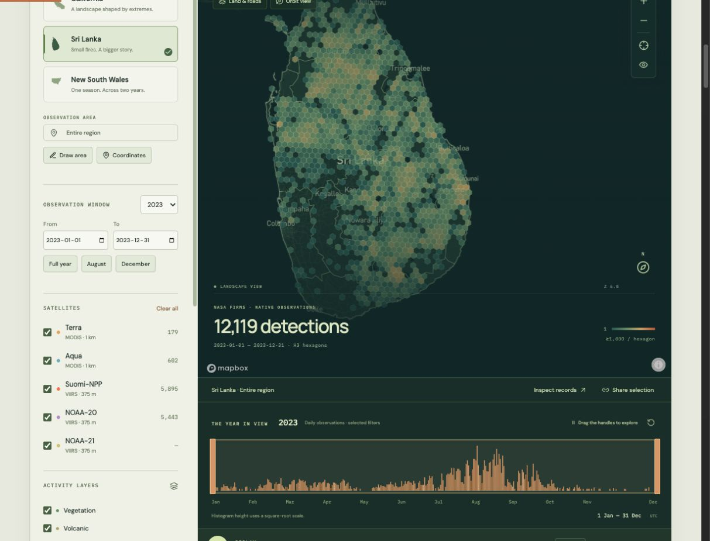
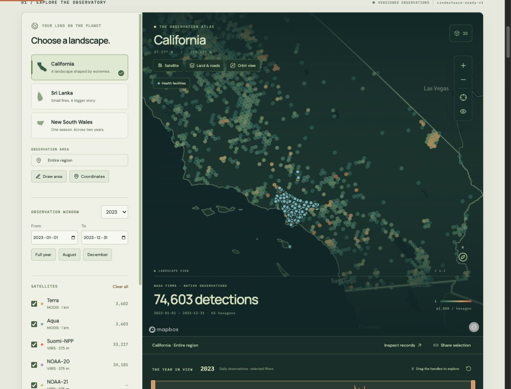

<div align="center">

# CinderTrace

### Every signal. A clearer story.

Explore satellite fire observations and published fire history across<br />
**Sri Lanka · California · New South Wales**


[Explore the features](#explore-the-features) · [Run locally](#run-locally) · [Deploy to Vercel](#deploy-to-vercel) · [Data and methods](#data-and-methods)

</div>



CinderTrace is a browser-based observatory for exploring where satellites recorded fire detections, how those observations change over time, and what published historical estimates can add to the picture. It brings geographic exploration, seasonal analysis, dated satellite imagery, and downloadable evidence into one interface.

The active application is a **static React site**. Its prepared data snapshot is included in this repository, so running or hosting the frontend does not require a Python server, Earthdata login, or a notebook session. A public Mapbox token configures the basemap.

> **Reading the map:** a satellite detection is an observation, not a unique wildfire. Detection counts do not measure burned area or establish complete satellite coverage. Native observations and third-party historical estimates are presented as separate evidence.

## At a glance

| Native pixel observations | Regional landscapes | Snapshot period | Delivery |
| :---: | :---: | :---: | :---: |
| **5,072,279** | **3** | **2000–2026** | **Static frontend** |

These figures describe the committed snapshot. The archive begins in November 2000; individual satellites have different operating periods, and the application is not a live incident feed.

## Explore the features

### A geographic lens on satellite observations

Choose a landscape, select a year, and narrow the UTC date window with the timeline. Filter by satellite, published detection type, native confidence, quality, and geographic area. The map, calendar, record inspector, and observed-data export share the same selection.

- **Regional and custom areas:** explore administrative units, draw a polygon, or select a coordinate and radius.
- **Inspect individual records:** retain acquisition time, satellite identity, record IDs, and source fingerprints.
- **Flat and raised maps:** switch to a Three.js hexagon view and use the optional camera orbit.
- **Temporal exploration:** brush the daily timeline or play through supported months at three speeds.

<table>
<tr>
<td width="50%"></td>
<td width="50%"></td>
</tr>
<tr>
<td align="center"><strong>Sri Lanka</strong><br />Inspect the island's observed detection patterns.</td>
<td align="center"><strong>California</strong><br />Explore observations alongside geographic context.</td>
</tr>
</table>

Hexagons group records at H3 resolution 6 for display. The colour scale saturates at 1,000 observations per cell. Raised column heights use a capped logarithmic display of counts; they do not represent physical fire height or intensity. CSV downloads preserve individual observations.

### Historical calendars and seasonal patterns

The published-history workspace uses attributed **Fire Harmony v1.0** monthly estimates to provide a longer historical reference.

| View | What you can explore |
| --- | --- |
| Burning calendar | Monthly activity, anomaly, and percentile patterns |
| Seasonal patterns | Median, interquartile range, P10–P90 envelope, and selected-year overlays |
| Annual summaries | Complete-year totals, peak activity month, and top-three-month share |
| Compare years | Two native geographic patterns alongside a shared-scale historical chart |
| Regional context | Available administrative rankings and sensor-history context |

New South Wales supports January–December and July–June year definitions. Annual summaries require twelve non-null monthly provider values. Missing months remain visible and are excluded from complete-year comparisons.

### See the landscape behind the records

Compare two dates of NASA GIBS Terra or Aqua imagery with a swipe divider, overlay selected observations, and export a PNG. Six example frames are bundled; loading other dates requires access to NASA services.


Optional geographic layers add health facilities, response facilities, settlements, and protected areas. Each layer includes source and coverage information. Proximity is a geographic calculation and does not establish damage or exposure at the time of a historical observation.

### Take the evidence with you

| Export or tool | Contents |
| --- | --- |
| **Observed CSV** | Selected point records, acquisition UTC, satellite, confidence, type, quality, FRP, record IDs, and source-file SHA256 |
| **Historical CSV** | Provider monthly series with published zeros, missing rows, unavailable values, and provenance preserved |
| **Calendar PNG** | Selected historical calendar with its metric, baseline, and colour-scale labels |
| **Area brief PDF** | Selection, vector map, daily bars, metrics, and a separately attributed historical reference |
| **Detailed visual PDF** | Expanded findings, loaded imagery, geographic context, validation material, and notes |
| **Evidence pack** | Notes, selection metadata, CSV, daily SVG, detailed PDF, receipts, and loaded imagery with source requests |
| **Data manifest** | Source revisions and SHA256 fingerprints for 90 dataset files |

Field notes and saved investigations stay in browser storage. Selection explanations use deterministic calculations. A service worker caches the application shell and a bounded set of visited archives for later use; unvisited datasets and external basemap tiles still require connectivity.

## Run locally

### Requirements

- **Node.js 22.6 or later**; Node.js 22.x is the documented deployment target.
- **npm**, using the committed lockfile.
- A **public Mapbox browser token** for the observation basemap.
- A modern browser with WebGL support for the map and 3D views.

### 1. Clone and install

```bash
git clone https://github.com/kavishan-weer/CinderTrace.git
cd CinderTrace/web
npm ci
```

### 2. Configure the map

```bash
cp .env.example .env.local
```

Add your public browser token to `web/.env.local`:

```dotenv
VITE_MAPBOX_ACCESS_TOKEN=your_public_mapbox_token
```

Authorize the origins you use in your Mapbox token settings. The example environment file also documents `VITE_CARTO_BASEMAP_KEY` for CARTO configuration. Vite exposes `VITE_` variables to the browser, so use public browser credentials here. Local environment files are excluded from Git.

### 3. Start the application

```bash
npm run dev
```

Open the local URL printed in the terminal. The prepared data in `web/site-public/ready/` is already committed; Python processing is unnecessary for normal frontend development.

### Build, preview, and test

Run these commands from `web/`:

```bash
npm test
npm run build
npm run preview
```

`npm run build` checks TypeScript and produces `web/dist/`. The frontend suite covers selection and export consistency, real snapshot counts, missing-data handling, annual completeness, baselines, imagery, geographic context, and report calculations.

## Deploy to Vercel

Import this GitHub repository into Vercel. When multiple applications are detected, choose **Import single project** beside **web · Vite**.

| Setting | Value |
| --- | --- |
| Root Directory | `web` |
| Framework Preset | `Vite` |
| Install Command | `npm ci` |
| Build Command | `npm run build` |
| Output Directory | `dist` |
| Node.js Version | `22.x` |
| Environment Variable | `VITE_MAPBOX_ACCESS_TOKEN` = your public Mapbox browser token |

Set the environment variable for each deployment environment you use, authorize the deployment domain in Mapbox, and deploy. Changes to browser environment variables require a new build.

The Python research application is not required by the active frontend. Keep `web/site-public/ready/` tracked: the build checks for its manifest, and the browser needs its archives. Preserve `.json.gz` filenames when hosting; the client supports both host-provided gzip content encoding and direct browser decompression.

<details>
<summary><strong>Deployment troubleshooting</strong></summary>

| Symptom | Check |
| --- | --- |
| Vercel selects a Python app | Import the `web` Vite application and set Root Directory to `web`. |
| Build reports “Ready dataset missing” | Confirm `web/site-public/ready/manifest.json` and its dataset files are present in the deployed Git branch. |
| Basemap is missing | Check the public Mapbox token, authorized origins, network access, and whether the token was available during the build. |
| An archive fails to load | Check that `.json.gz` files were deployed intact and their URLs return the dataset rather than an HTML fallback. |
| Previously visited data works offline but another year does not | Only a bounded set of visited archives is cached. Load the required year while connected. |

</details>

## Data and methods

### The committed observation snapshot

| Region | Native observations | Last recorded detection |
| --- | ---: | --- |
| Sri Lanka | 207,310 | 2026-11-04 |
| California | 2,168,313 | 2026-11-12 |
| New South Wales | 2,696,656 | 2026-11-12 |
| **Total** | **5,072,279** | — |

Dates describe records in the snapshot, not evidence of complete observing coverage. Archives load one region and year at a time.

Sri Lanka's 2000–2024 subset uses an official-source-reconciled standard-data checkpoint containing **171,244 observations**. Later Sri Lanka records and the California and New South Wales archives use local Portolan FIRMS mirror snapshots, clipped to reference region polygons. Exact duplicate source records are removed; observations from different satellites remain separate. Missing type values remain unattributed, and standard and near-real-time records remain distinguishable.

### Two complementary kinds of evidence

| | Native observations | Published historical reference |
| --- | --- | --- |
| Source | NASA FIRMS observations via the documented source checkpoints and Portolan mirrors | Fire Harmony v1.0 |
| Unit | Individual satellite pixel detection | Third-party monthly derived activity estimate |
| Selection | Region, time, satellite, confidence, quality, type, and supported geographic area | Provider's published geographic and methodological scope |
| Interpretation | Records observed in the selected extract | Historical reference on the publisher's NOAA-20 scale |

Historical provider values do not inherit arbitrary polygons or native observation filters. Sri Lanka has 25 published administrative units; California county and NSW LGA modelled values are not supplied.

The provider dataset is pinned to revision `9c1c703472d727d9f9b42477df39440bb34b2b64`. Historical anomaly and percentile calculations use matching months from 2001–2025, exclude the selected year, and require at least five reference values. Zero-median anomalies remain unavailable. Seasonal envelopes describe historical variability, rather than prediction confidence.

### Interpretation and validation

- Detection counts are **not unique fires, burned area, normalized activity, or proof of observing completeness**. Zero means no matching records in the extract.
- MODIS and VIIRS have different observation characteristics. Sensor transitions affect counts; FRP means and nighttime shares require a single-satellite selection.
- Clouds, coverage gaps, unsupported sensor periods, and request failures affect what can be observed or displayed. Unavailable values remain distinct from zero.
- The validation lab separates source reconciliation from geographic concordance with the official CAL FIRE Creek Fire final perimeter. Concordance does not establish detection accuracy or forecasting performance.
- Context inventories are contemporary snapshots, not historical exposure inventories. Geographic proximity does not establish damage.
- Earlier calibration and outlook work remains research material. The active frontend does not claim completed coverage, allocation-uncertainty, or replacement-model validation.

For the full frontend notes, read [the application README](web/README.md). Verification material includes the [data receipt](docs/ready_site_data_receipt.json), [release checks](docs/ready_site_release_checks.json), and [coverage validation notes](docs/coverage_validation.md).

## How the application is built

```text
Prepared regional archives + attributed historical reference
                         │
                         ▼
              Static files in site-public/
                         │
                         ▼
             React + TypeScript + Vite
                         │
          ┌──────────────┼──────────────┐
          ▼              ▼              ▼
    Map and records  History views  Reports and exports
```

| Layer | Technologies and purpose |
| --- | --- |
| Interface | React 19, TypeScript, Lucide icons |
| Build | Vite 6 and TypeScript project checks |
| Geography | Mapbox GL, H3 spatial grouping, and deck.gl components in the repository |
| Visual experience | Three.js terrain and raised hexagons; GSAP motion with reduced-motion handling |
| Reports | jsPDF and browser-side graphics/export utilities |
| Compression | fflate and browser decompression for compressed archives and evidence packs |
| Research and preparation | Python pipeline, validation scripts, and Jupyter notebooks |
| Hosting | Static `dist/` output, suitable for Vercel |

## Repository guide

```text
CinderTrace/
├── README.md                 # Project overview and setup
├── web/                      # Active static frontend
│   ├── src/                  # React interface, calculations, and frontend tests
│   ├── site-public/
│   │   ├── ready/            # Required versioned observation and provider archives
│   │   ├── context/          # Geographic layers and bundled imagery
│   │   └── validation/       # Source reconciliation and case-study material
│   ├── scripts/              # Development and visual-report utilities
│   └── .env.example          # Public browser configuration template
├── pipeline/                 # Data preparation, export, and verification
├── ml/                       # Earlier analytical research components
├── notebooks/                # Reproducibility and research notebooks
├── scripts/                  # Context exports and notebook preparation
├── tests/                    # Python pipeline and research tests
└── docs/                     # Methods, receipts, validation, and README images
```

Raw local research data, Python environments, dependencies, build output, temporary captures, and local credentials are ignored. The prepared browser dataset remains tracked so a fresh clone can build the site.

<details>
<summary><strong>Regenerating the prepared site data</strong></summary>

Normal frontend setup uses the committed snapshot. Rebuilding it requires the original downloaded/checkpoint inputs and the relevant Python environment; those raw inputs are not all included in Git.

From the repository root, with the required inputs available:

```bash
.venv/bin/python -m pipeline.export_ready_site
```

The exporter checks provider and canonical input hashes before preparing the browser files. Build the frontend afterward from `web/` with `npm run build`.

Additional context, imagery, and validation preparation scripts live in `scripts/`. Research requirements are recorded in `requirements.txt`, `requirements-observations.txt`, and `requirements-atlas-observations.txt`. Consult the relevant pipeline and method documentation before regenerating a research product.

</details>

## Sources, attribution, and licensing

CinderTrace keeps source attribution and methodological limits visible in its interface, manifests, and exports.

| Source | Contribution |
| --- | --- |
| NASA FIRMS | Underlying satellite fire observations |
| [Portolan FIRMS catalogue](https://github.com/portolan-mirrors/firms-catalog) | Mirrored observation snapshots; Portolan publishes its data as CC0 |
| [Fire Harmony — Kopi and Cosmos](https://github.com/Warren-530/fire-harmony) | Published historical reference by **Saw Yong Quan and Yap Yong Son** |
| [Pinned Fire Harmony dataset](https://huggingface.co/datasets/warrensaw530/fire-harmony/tree/9c1c703472d727d9f9b42477df39440bb34b2b64/v1.0) | Historical monthly data under **CC BY 4.0** |
| geoBoundaries | Supplied reference region boundaries |
| NASA GIBS | Dated Terra/Aqua imagery |
| Mapbox and OpenStreetMap | Basemap and geographic reference services, with attribution retained |
| Regional public agencies and Natural Earth | Context inventories and reference layers; individual sources are documented with the layers |

Fire Harmony's upstream code licence and dataset licence are distinct. Dataset, map, and imagery rights remain governed by their respective sources. This repository does not currently include a project-wide `LICENSE` file; do not infer a licence for all CinderTrace code or assets from an upstream dependency or dataset.

---

<div align="center">

**Observe the pattern. Keep the context.**

[Getting started](#run-locally) · [Deployment](#deploy-to-vercel) · [Application documentation](web/README.md)

</div>
