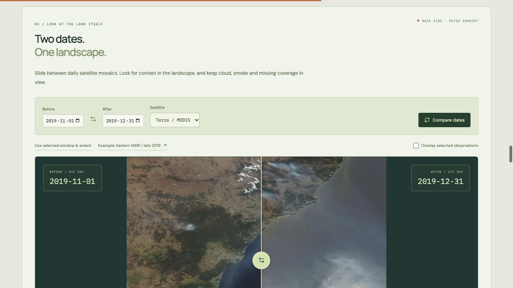

# CinderTrace

### Every signal. A clearer story.

An interactive burning activity calendar and satellite observation explorer

**Sri Lanka · California · New South Wales**

NASA Space Apps Challenge 
**Harmonization of MODIS and VIIRS Hot Spots**

[Project features](#the-experience) · [Data and method](#data-and-method) · [Sources and credit](#sources-and-credit)

CinderTrace helps people investigate where satellites recorded fire detections and how burning activity varies over time. It combines more than five million NASA FIRMS observations with an attributed published historical reference, dated satellite imagery and downloadable reports.

We built the application to make complex Earth observation records easier to explore. A user can start with a regional calendar, investigate a place and date, inspect the underlying observations, and share the findings with their source information attached.

## The challenge

MODIS and VIIRS provide a long record of active fire observations, but their spatial resolution, sensitivity and observing schedules differ. Understanding historical patterns requires a consistent reference and a way to examine the original records.

CinderTrace addresses this through an observation explorer and a burning activity calendar. The explorer preserves satellite-level detail. The calendar uses **Fire Harmony v1.0**, an existing published harmonized dataset, to provide monthly historical context on its provider’s NOAA-20 scale. Source labels make the role of each dataset clear throughout the application.

## The experience

### Explore a landscape

Choose Sri Lanka, California or New South Wales. Filter observations by year, UTC date window, satellite, confidence and published source attributes. Select an administrative area, draw a polygon, or enter coordinates and a radius. The map, timeline, record inspector and observed CSV use the same selection.

<table>
<tr>
<td width="50%"></td>
<td width="50%"></td>
</tr>
<tr>
<td align="center"><strong>Sri Lanka observation explorer</strong></td>
<td align="center"><strong>California with geographic context</strong></td>
</tr>
</table>

### Read the historical calendar

Explore monthly activity, anomalies and percentiles. Seasonal charts show the historical median and variability alongside a selected year. Compare years on a shared scale, examine complete-year summaries, and switch New South Wales to a July–June calendar to follow seasons across two years.

### Add imagery and local context

Compare two dates of NASA MODIS imagery with an interactive swipe divider. Overlay selected observations and explore nearby health facilities, response facilities, settlements and protected areas. Each context layer includes its source details.

### Save and share an investigation

Guided investigations and monthly playback help users explore the archive. Field notes and saved selections keep an investigation together. Export individual observations as CSV, historical series, calendar images or visual PDF reports. An evidence pack combines selected records, charts, notes, metadata and source receipts.

## Data and method

The prepared archive spans **2000–2026** and contains **5,072,279 satellite pixel observations**:

| Region | Observations |
| --- | ---: |
| Sri Lanka | 207,310 |
| California | 2,168,313 |
| New South Wales | 2,696,656 |

1. **Prepare the observations.** We use NASA FIRMS records from MODIS and VIIRS, obtained through an official-source-reconciled Sri Lanka checkpoint and Portolan’s regional mirror extracts. Python processing selects records within reference boundaries, removes exact duplicate source records and organises the archive by region and year.
2. **Preserve the source detail.** Each observation retains its time, coordinates, satellite, native confidence, source type, quality and recorded fire radiative power. SHA256 fingerprints connect prepared files to their inputs. H3 hexagons group observations for map display, while inspection and CSV exports preserve individual records.
3. **Integrate published history.** We pin a specific Fire Harmony v1.0 dataset revision and build the calendar and historical analytics around its monthly estimates. Anomaly and percentile calculations compare matching months in 2001–2025, excluding the selected year. Annual summaries use complete twelve-month provider series.
4. **Check the results.** We reconciled 171,244 Sri Lanka standard-data records for 2000–2024 against the authoritative checkpoint on nine native fields. The validation lab also presents a geographic comparison with CAL FIRE’s Creek Fire final perimeter. Automated checks cover selections, dataset counts, historical calculations, imagery requests and reports.

The explorer reports recorded satellite pixel observations. The calendar reports provider-derived monthly activity within its published geographic scope. These source definitions accompany the relevant views and exports.

## Design and development

We developed the interface with **React and TypeScript**, using **Vite** for the build. **Mapbox GL** powers the map, **H3** groups geographic observations, and **Three.js** provides the terrain illustration and raised hexagon view. **GSAP** handles camera movement and interface animation, with reduced-motion support.

The data workflow uses **Python, pandas, NumPy and Shapely** for preparation and geographic processing. **jsPDF** generates reports in the browser, and **fflate** packages evidence downloads. Prepared, compressed archives load by region and year. Saved investigations use browser storage, and field mode caches the interface and recently visited archives.

The visual design uses a sage and forest palette with ember accents, Manrope and DM Sans typography, and IBM Plex Mono for data labels. Shared filters connect exploration and export so users can follow the same selection through an investigation.

## Intended impact

CinderTrace supports environmental education, historical research and planning discussions. Students and researchers can inspect the records behind a pattern. Land managers and responders can explore selected places alongside imagery and geographic context. Downloadable evidence makes those investigations easier to review and communicate.

## Sources and credit

| Resource | Contribution |
| --- | --- |
| [NASA FIRMS](https://firms.modaps.eosdis.nasa.gov/) | MODIS and VIIRS active fire observations |
| [NASA GIBS](https://nasa-gibs.github.io/gibs-api-docs/) | Dated MODIS Terra and Aqua true-colour imagery |
| [Portolan FIRMS catalogue](https://github.com/portolan-mirrors/firms-catalog) | Mirrored satellite observation archives |
| [Fire Harmony dataset](https://huggingface.co/datasets/warrensaw530/fire-harmony) and [method](https://github.com/Warren-530/fire-harmony) | Published harmonized monthly reference by **Kopi and Cosmos: Saw Yong Quan and Yap Yong Son**, used under **CC BY 4.0** |
| [geoBoundaries](https://www.geoboundaries.org/) | Reference administrative boundaries |
| [Mapbox](https://www.mapbox.com/) and [OpenStreetMap contributors](https://www.openstreetmap.org/copyright) | Basemaps and geographic reference |
| [Natural Earth](https://www.naturalearthdata.com/) and regional public agencies | Settlement, facility and protected-area layers |

Regional context draws on Sri Lanka NSDI, the California Department of Public Health, CAL FIRE, the US National Park Service, NSW Spatial Services, Fire and Rescue NSW, and the NSW National Parks and Wildlife Service. Detailed layer credits appear in the application and [source inventory](web/site-public/context/sources.json).

Source revisions and file fingerprints are available in the [dataset manifest](web/site-public/ready/manifest.json). The application’s **Data & method** section explains the workflow, with supporting [data receipts](docs/ready_site_data_receipt.json) and [validation records](web/site-public/validation/showcase.json) available in this repository.
