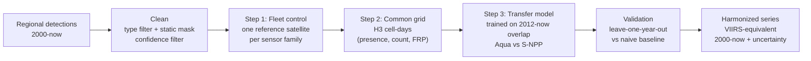
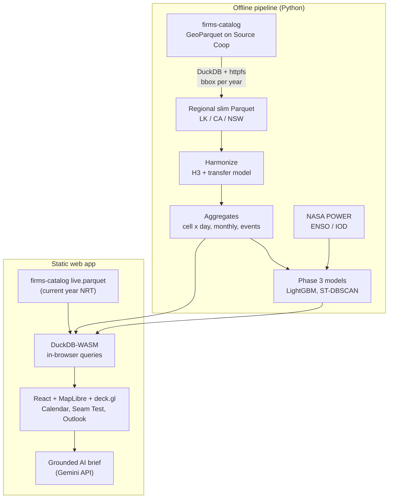

# 🔥 EMBERLINE: Winning Strategy (v2)

> **Tagline:** *25 years of fire, one consistent record. And it tells you what's coming.*

**What changed in v2 (from your comments):**
- ✅ **Data:** [portolan-mirrors/firms-catalog](https://github.com/portolan-mirrors/firms-catalog) is the source. I checked it live (see §2).
- ✅ **Regions:** Sri Lanka 🇱🇰 · California 🇺🇸 · New South Wales 🇦🇺
- ✅ **Structure:** Phase 1 Harmonization → Phase 2 Web App → **Phase 3 AI/ML "go beyond" layer** (built last, but designed in from day one)

---

## 1. Why these three regions are a great choice

They're three very different fire regimes. That's exactly what shows a single correction factor fails, and that our regime-aware harmonization works.

| | 🇱🇰 Sri Lanka | 🇺🇸 California | 🇦🇺 NSW |
|---|---|---|---|
| **Regime** | Tropical, smallholder *chena*/agricultural + grassland burns | Mediterranean, large wildland megafires | Temperate eucalypt forest + grassland |
| **Fire size** | Many **small, cool** fires | Few **huge, intense** fires | Mixed; extreme events |
| **Season** | Bimodal, monsoon-driven (Yala / Maha dry periods) | Jun–Nov | **Crosses the calendar year** (Sep–Mar) |
| **Climate driver** | ENSO + Indian Ocean Dipole | Drought, heat, offshore winds | ENSO + IOD (Black Summer 2019–20) |
| **Harmonization difficulty** | 🔴 Hardest: VIIRS sees far more than MODIS | 🟢 Easier: big fires are seen by both | 🟡 Medium |
| **Story** | *"Fires the old satellites missed"* | *"Is the megafire era real, or a sensor artifact?"* | *"Could we have seen Black Summer coming?"* |

> [!IMPORTANT]
> **Expert touch:** for NSW, use a **fire year (Jul–Jun)** instead of a calendar year. Otherwise every Southern Hemisphere fire season gets split in half. Few teams will notice this.

---

## 2. Data source: firms-catalog (verified ✅)

**What it is:** every MODIS and VIIRS detection from Nov 2000 to today (~631M rows) as year-partitioned **GeoParquet 2.0** on Source Cooperative, queryable in place with DuckDB, with **no FIRMS API key or rate limits** for history.

**Live check I ran** (Sri Lanka bbox, 2016, ~20 s over HTTP, [probe script](file:///Users/kavishanwee/.gemini/antigravity/brain/9d72fcf6-14a9-4627-8b9a-9747ca226d97/scratch/probe_srilanka_2016.py)):

| Satellite | Detections | Mean FRP (MW) |
|---|---|---|
| Aqua (MODIS) | 1,028 | 24.4 |
| Terra (MODIS) | 460 | 19.6 |
| **Suomi-NPP (VIIRS)** | **12,063** | **6.0** |

👉 **VIIRS sees 11.7× more hotspots than Aqua over Sri Lanka**, and those extra detections are **4× weaker** (lower FRP). That's the physical basis of our method: VIIRS catches small, low-power fires that MODIS can't. **This is real evidence for the pitch before we've written any app code.**

### What the catalog gives us (and its traps)

| Useful | Trap to handle |
|---|---|
| `satellite` column (Terra / Aqua / Suomi-NPP / NOAA-20 / NOAA-21) | Raw counts jump **5.5×** in 2012, **1.55×** in 2018, **1.44×** in 2024 from **fleet growth, not fire** |
| `frp`, `scan`, `track`, `daynight` | `scan`/`track` are **km for MODIS, m for VIIRS** |
| `type` (0 = vegetation) | `type` is **NULL for all NRT rows** → use `type = 0 OR type IS NULL` for recent data, then apply our own static-source mask |
| `quality` (`sp` / `nrt`) | Confidence scales differ (MODIS 0–100 vs VIIRS l/n/h), with **no official crosswalk** |
| Pre-aggregated A5 grids | Grids have **no sensor × day cross-tabs**, so harmonization needs the point-level detections |

**Plan:** pull **point-level detections per region bbox per year** (2000–now) once, clip to the region boundary, save slim regional Parquet files. Estimated at around 26 years × 3 regions × ~20–60 s each, so a one-time job of about 1 hour.

> [!TIP]
> **Bonus:** we can build our own **static-source mask** (cells flagged `type = 1/2` in science-quality years) and apply it to NRT rows, which fixes the catalog's NULL-type gap. A small, clever detail judges notice.

---

## 3. PHASE 1: Harmonization ("the sensor no longer matters")

### Core idea: three-step physics-informed harmonization



**Step 1, fleet control (removes fake jumps):**
- MODIS reference = **Aqua** (13:30 overpass). For Nov 2000–Jun 2002 (Terra only), map Terra → Aqua-equivalent using their 2002–now overlap.
- VIIRS reference = **Suomi-NPP**. NOAA-20/21 are used only for gap-filling and validation, never stacked.
- **Why Aqua + S-NPP?** They cross the equator at nearly the same local time, so it's the cleanest like-for-like calibration pair.

**Step 2, common grid:** points → **H3 cells (res 6–7) × day**. Keep three metrics per cell-day: *presence*, *count*, *ΣFRP*. Presence (fire-active cell-days) is the most resolution-robust unit.

**Step 3, transfer model** (MODIS-Aqua → S-NPP-equivalent), trained on the overlap:

| Level | Method | Role |
|---|---|---|
| Baseline | One global ratio | What other teams do. We show it failing. |
| **v1 (MVP)** | Ratio stratified by **region × land cover × month** + quantile mapping | Solid, explainable |
| **v2 (Phase 3)** | **LightGBM** with MODIS count, FRP stats, scan angle, land cover, month, day/night | Best accuracy + uncertainty via quantile regression |

**Validation:** leave-one-year-out on 2012–now. Report **R², bias, MAE** for *naive vs v1 vs v2* in each region. The expected headline:

> *"A single global factor is off by up to X× in Sri Lanka. Our regime-aware model cuts error by Y%."* (X and Y come from our validation, never guessed.)

**Output unit:** **VIIRS-equivalent hotspots** (future-proof, since MODIS is retiring) + **fire-active cell-days** + **ΣFRP**, each with an uncertainty band.

**Known limitations (we state them openly):** late-mission orbit drift of Terra/Aqua, cloud-cover bias, NRT geolocation error, no burned-area claims.

---

## 4. PHASE 2: Web app (the challenge baseline, done exceptionally)

| Priority | Feature | Detail |
|---|---|---|
| **P0** | **Region & AOI selection** | Region picker (LK / CA / NSW) + draw polygon + lat/lon + admin district (LK districts, CA counties, NSW LGAs) |
| **P0** | **Date-range selection** | Brush on a timeline, 2000–now |
| **P0** | **Burning calendar** | Month × Year heatmap, **cividis / viridis** (colorblind-safe), toggle *Counts / Anomaly vs median / Percentile*, fire-year mode for NSW |
| **P0** | **Seam Test** 🎯 | Raw MODIS · Raw VIIRS · Harmonized, which visually proves the 2012 jump is gone. **Demo opener.** |
| **P0** | **"Now vs History" card** | Current month vs historical median + percentile rank |
| **P0** | **Downloads** | CSV (raw hotspots + harmonized monthly series), PNG charts, method notes |
| **P1** | **Fire season phenology** | Onset / peak / end / length per year + trend ("starts 19 days earlier") |
| **P1** | **Region comparison** | LK vs CA vs NSW side by side, normalized per km² |
| **P1** | **Situation Brief PDF** | One page, plain language, for emergency managers |
| **P2** | **Accessibility & field mode** | WCAG contrast, keyboard nav, PWA offline, low-bandwidth mode |

---

## 5. PHASE 3: AI/ML "go beyond" layer (build last, design for it now)

The challenge describes two parts (harmonize + visualize). Phase 3 is how we **go beyond** both. Ranked by *impact ÷ effort*:

### 🥇 3A. Fire *events*, not just hotspots (spatio-temporal clustering)
- **What:** cluster detections into **fire events** with ST-DBSCAN (space + time), giving *number of fires, duration, spread, peak FRP*.
- **Why it wins:** the catalog itself states that counting fires "needs spatio-temporal clustering, which this catalog does not do". We fill that gap. The challenge asks for *"number of fires detected"*, and almost every team will show pixels instead.
- **Bonus:** events also harmonize better than pixels, since one fire is one fire on both sensors.

### 🥈 3B. Probabilistic Fire Outlook (early warning)

> **Implementation update — 2026-11-14:** the local outlook pipeline and 2019–2025 rolling validation are built. NASA POWER + ONI/DMI are tested against seasonal and history-only baselines. Results are mixed and none of the nine region/lead combinations passes the combined numerical gate. The initial target uses directly observed S-NPP activity, avoiding future-calibrated pre-2013 transfers. It remains outside the app. See [validation report](docs/fire_outlook.md). The Black Summer story below was a hypothesis, not an established result; the August 2019 hindcast does not support that claim.

> **Calibration follow-up — 2026-11-14:** a locked, regularized sigmoid calibrator uses only matured 2019–2025 out-of-sample forecasts. A newly scored January–September 2026 holdout improves probability error relative to raw ML in Sri Lanka and NSW, but worsens California. Seasonal history still wins seven of nine region/lead comparisons; nine months is insufficient release evidence. [Full calibration results](docs/outlook_calibration.md). No outlook app panel is added.

- **What:** forecast the next **1–3 months** of harmonized fire activity as a probability ("70% chance of above-normal activity").
- **Inputs (NASA-first):** harmonized history + **NASA POWER** (rainfall, temperature, humidity, wind) + **ENSO (ONI)** and **IOD (DMI)** indices.
- **Model:** LightGBM quantile regression → P10 / P50 / P90 fan chart.
- **Story:** *"Hindcast: in Aug 2019, our model flagged NSW as 'well above normal' for the coming summer."* Validate honestly with a hindcast.

### 🥉 3C. Burning regime classifier
- **What:** an unsupervised model labels each cell's regime: *agricultural / wildland / deforestation-clearing / industrial-persistent*, using diurnal pattern, FRP, seasonality, persistence and land cover.
- **Why:** turns Sri Lanka's "noise" into insight (chena burning vs wildfire). Responders care which is which.

### 🏅 3D. Grounded AI Analyst (LLM)
- **What:** "Explain this area" turns computed stats into a plain-language brief, plus natural-language questions ("Which 3 years had the worst March?") via **text-to-SQL over DuckDB**.
- **Guardrail:** the LLM **only narrates numbers our pipeline computed** and every figure links to its chart. No hallucinated stats. Pitch this as *trustworthy AI*.

> [!NOTE]
> Lots of teams will bolt on "an AI chatbot". Ours is different: **3A and 3B are real ML that do the science**, and 3D just explains it. Lead with 3A/3B, use 3D as the finishing touch.

---

## 6. Architecture



- **Pipeline:** Python, DuckDB (`spatial`, `httpfs`), Polars, `h3`, scikit-learn, LightGBM
- **Frontend:** React + Vite + TypeScript, MapLibre GL, deck.gl `H3HexagonLayer`, terra-draw, Observable Plot / D3, **DuckDB-WASM** (no backend)
- **Near-real-time:** the catalog's hourly-updated current-year data → apply harmonization → "now vs history"
- **Deploy:** static hosting (GitHub Pages / Netlify / Vercel)

### Proposed repo layout (`ignite/`)
```
ignite/
├── pipeline/        # Phase 1: fetch, clean, harmonize, validate
│   ├── fetch.py
│   ├── harmonize.py
│   ├── validate.py
│   └── regions/     # LK, CA, NSW boundaries (GeoJSON)
├── ml/              # Phase 3: events, outlook, regimes
├── web/             # Phase 2: React app
├── data/            # generated Parquet (gitignored)
└── docs/            # method + validation report
```

---

## 7. Demo script (about 2 minutes)

1. **Hook (Sri Lanka):** *"In 2012, Sri Lanka's fires apparently increased 10×. They didn't. A new satellite arrived."* → **Seam Test**: raw jump → harmonized, smooth.
2. **Proof:** validation table, naive ratio vs ours, three regions.
3. **California:** *"Is the megafire era real?"* → harmonized calendar + phenology: *"season now ends X weeks later."*
4. **NSW:** Black Summer in the calendar (fire-year view) → **Outlook hindcast**: *"Our model flagged it in August 2019."*
5. **Action:** draw an AOI → "Now vs History: 94th percentile" → **Generate Brief** → PDF + CSV.
6. **Close:** *"Sensor-independent. Evidence-based. Built for the people who fight fires."*

---

## 8. Build plan

| Stage | Phase | Deliverable |
|---|---|---|
| **Now (before hackathon)** | Data | Regional fetch for LK/CA/NSW 2000–now, boundaries, slim Parquet |
| **Block 1** | Phase 1 | Cleaning, fleet control, H3 grid, naive baseline |
| **Block 2** | Phase 1 | Stratified harmonization v1 + validation report |
| **Block 3** | Phase 2 | App shell, map, AOI, calendar, Seam Test, CSV |
| **Block 4** | Phase 2 | Now-vs-History, phenology, region compare, PDF brief |
| **Block 5** | Phase 3 | 3A events → 3B outlook → 3C regimes → 3D AI brief (in that order) |
| **Final** | Polish | Accessibility pass, method page, demo video, slides |

---

## 9. Risks & mitigations

| Risk | Mitigation |
|---|---|
| Remote queries slow (~20–60 s per region-year) | One-time offline fetch; app only reads small precomputed Parquet |
| California/NSW larger than Sri Lanka | Slim columns, clip to boundary, H3 aggregates for the map, points only for CSV |
| `type` NULL in NRT | Our own static-source mask from science-quality years |
| Harmonization underperforms in a region | Show the honest comparison with the baseline; transparency scores well with judges |
| Phase 3 runs out of time | Strictly ordered 3A → 3B → 3C → 3D; each is independently demoable |

---

## 10. Judging-criteria map

| Criterion | How EMBERLINE scores |
|---|---|
| **Impact** | Early-warning outlook, situation brief, fire-event counts for responders |
| **Creativity** | Seam Test, fire-year logic, regime classifier, events instead of pixels |
| **Validity** | Physics-based (FRP evidence), validated, uncertainty bands, named limitations |
| **Relevance** | Hits every objective: harmonize, calendar, AOI, date range, anomaly, CSV, accessible colors |
| **Presentation** | Three contrasting regions, three stories, one before/after visual proof |
